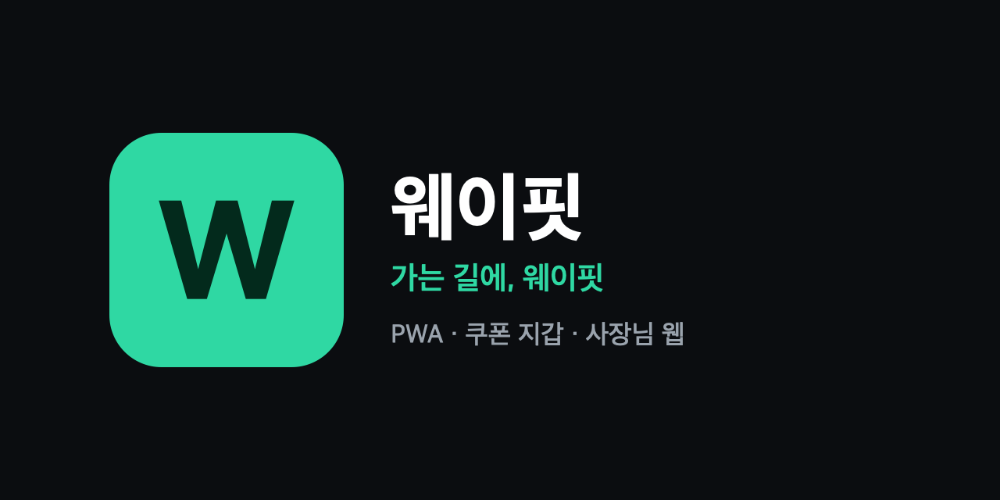

# 웨이핏 PWA — 쿠폰 지갑 + 사장님 웹



차에서 인증된 방문의 쿠폰을 **폰에서 받아 계산대에서 쓰는** 운전자용 쿠폰 지갑과, 소상공인이 혜택을 관리하고 실제 방문 효과를 보는 **사장님 웹**.
앱 설치 없이 차 화면 QR을 찍고 카카오로 로그인하면 연결된다. 사장님 웹도 같은 카카오 로그인을 쓴다.

- 스펙: `wayfit/specs/pwa/Spec.md` · 계획: `wayfit/specs/pwa/Plan.md`
- 디자인 규칙: [docs/DESIGN_SYSTEM.md](docs/DESIGN_SYSTEM.md)

## 화면
| 쿠폰함 | 계산대 화면 | 직원 PIN | 사용 완료 |
|---|---|---|---|
|  |  |  |  |

| 사장님 대시보드 | 매장 정보 · 차량 화면 미리보기 |
|---|---|
|  |  |

## 스택
Vite · React 19 · TypeScript · React Router · TanStack Query(+ localStorage 영속화) · Tailwind v4 · vite-plugin-pwa · MSW(목 API) · Vitest + Testing Library · Playwright

## 실행
```bash
npm install
npm run dev          # http://localhost:5173 — 백엔드 연동 전까지 MSW 목 API 로 동작
npm test             # 단위·화면 테스트 (Vitest, 목 API 공유)
npm run e2e          # 브라우저 E2E (Playwright, 개발 서버 자동 실행)
npm run screenshots  # E2E 를 돌리며 docs/screenshots 갱신
npm run build        # 프로덕션 빌드 (실제 API, PWA 서비스 워커 등록)
npm run build:demo   # 시연용 빌드 (목 API 포함) → dist-demo/
```

### 환경 변수
| 이름 | 기본값 | 설명 |
|---|---|---|
| `VITE_API_BASE` | `/v1` | 백엔드 주소 (예: `https://api.wayfit.app/v1`) |
| `VITE_USE_MOCK` | — | `true` 면 프로덕션 빌드에서도 목 API 사용 (시연용). 이때 PWA 서비스 워커는 등록하지 않는다 (MSW 워커와 범위 충돌) |
| `VITE_KAKAO_REST_API_KEY` | — | 카카오 앱 REST API 키 (인가 요청의 `client_id`, 공개값). 실제 API 모드에서 필수. 목 모드에서는 쓰지 않는다 |

`.env.example` 참고. 값은 `.env.local` 에 둔다 (커밋하지 않음).

## 카카오 로그인
- 인가 코드 방식. `state`로 로그인 CSRF를 막고(카카오는 PKCE 미지원), **코드 교환은 백엔드가 Client Secret으로** 한다. 브라우저에는 비밀값이 없다
- 콜백: `/auth/kakao/callback` — 카카오 콘솔의 Redirect URI에 `https://<배포 도메인>/auth/kakao/callback`(과 로컬 `http://localhost:5173/auth/kakao/callback`)을 등록하고, 백엔드 `KAKAO_REDIRECT_URIS`에도 같은 값을 넣는다
- 콜백은 `state`를 확인한 뒤 주소창에서 인가 코드를 지우고(`history.replaceState`), 로그인 전 화면(앱 안의 경로만)으로 돌아간다
- 세션 토큰은 `localStorage`(`wf.session`). 로그아웃·401이면 토큰과 영속 쿼리 캐시를 함께 지운다 (공용 폰)
- XSS로 토큰이 새지 않도록 `public/_headers`로 CSP를 건다 (Cloudflare Pages 배포에만 적용). 백엔드 주소를 바꾸면 `connect-src`도 맞춘다
- 목 모드는 카카오로 나가지 않고 콜백으로 바로 돌아와 로그인된다

## 목 API 데모 값
| 항목 | 값 |
|---|---|
| 연결 코드 | 차 화면에 뜬 **아무 8자리 코드** 정상 · `00000000` 만료 · `11111111` 이미 사용 · `99999999` 없는 코드 |
| 매장 PIN | `1234` (5회 틀리면 15분 잠금) |
| 카카오 로그인 | 버튼을 누르면 바로 로그인된다. 이 계정이 매장 `광교 모퉁이커피`의 사장님 |

목 데이터는 페이지를 새로 불러오면 초기화된다.

## 구조
```
src/
├── api/        client(fetch + Bearer) · errors(에러 코드 → 문장) · types(백엔드 계약) · queries(TanStack 훅)
├── mocks/      db(데모 데이터) · handlers(백엔드 Spec 동작 흉내) · browser/node(MSW)
├── lib/        auth(세션 토큰) · kakao(로그인 시작·state 확인) · env(목 모드) · coupon(분류·정렬·표시) · stats(전환율) · online
├── ui/         Button · Card/Badge/Page · Ticket · Sheet · OfflineBanner
├── features/
│   ├── auth/       카카오 로그인 버튼 · 콜백 (/auth/kakao/callback)
│   ├── pair/       차 QR 연결 (/pair?code=)
│   ├── coupons/    쿠폰함 · 계산대 화면 · PIN 패드 · 사용 완료
│   ├── settings/   연결된 차 관리
│   ├── install/    홈 화면 추가 안내
│   └── owner/      로그인 · 대시보드 · 매장 정보(+차량 카드 미리보기)
├── router.tsx
└── main.tsx    목/실제 API 분기, PWA 등록, 쿼리 캐시 영속화
e2e/            Playwright 시나리오
```

## 백엔드 연동 시
`src/api/types.ts`와 `src/mocks/handlers.ts`가 백엔드 Spec(Public API·Data Contracts)을 따른다. 백엔드가 배포되면 `VITE_API_BASE`만 지정하면 된다.
