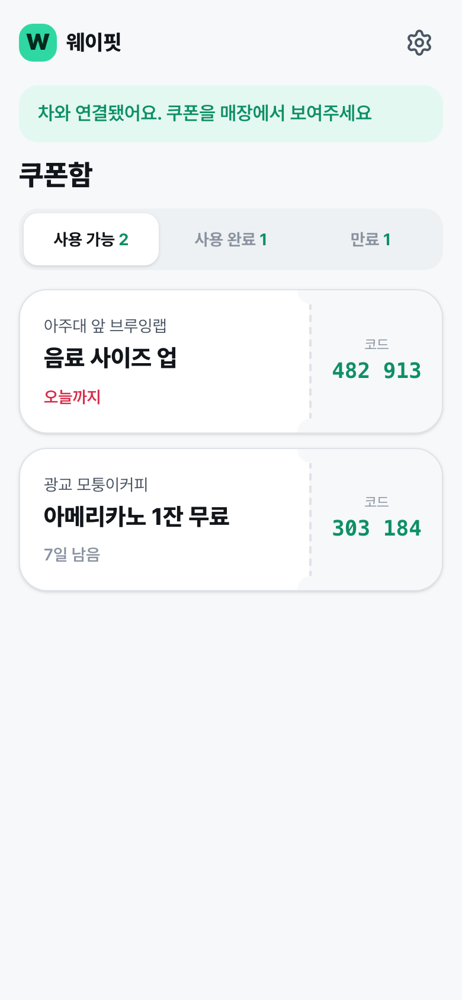
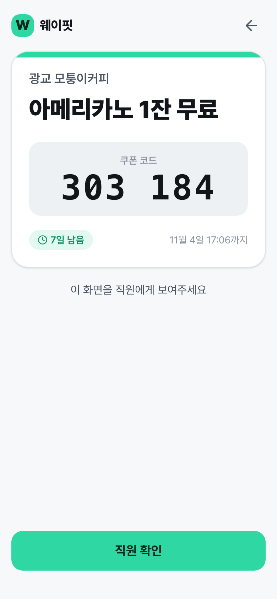
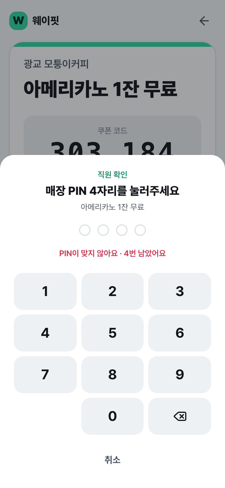
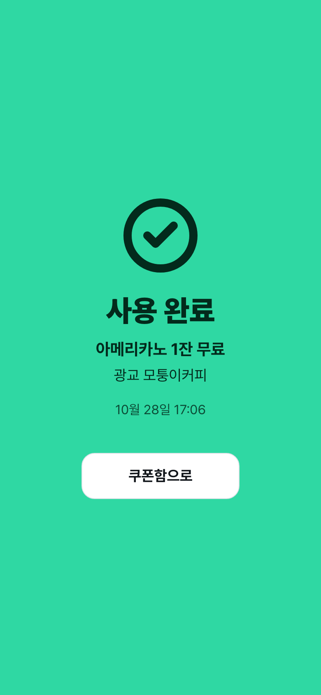
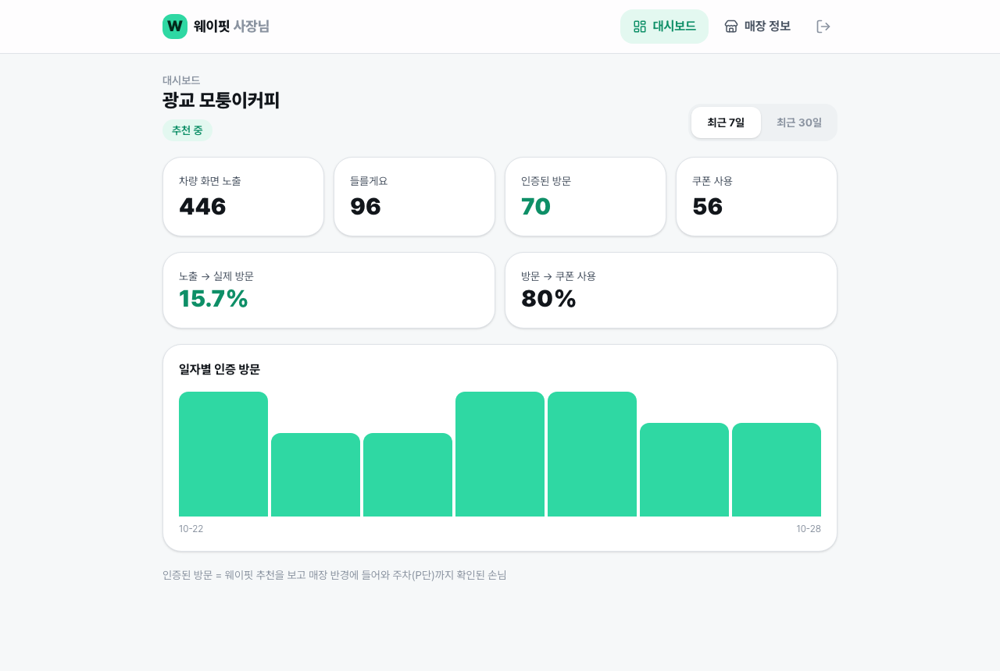
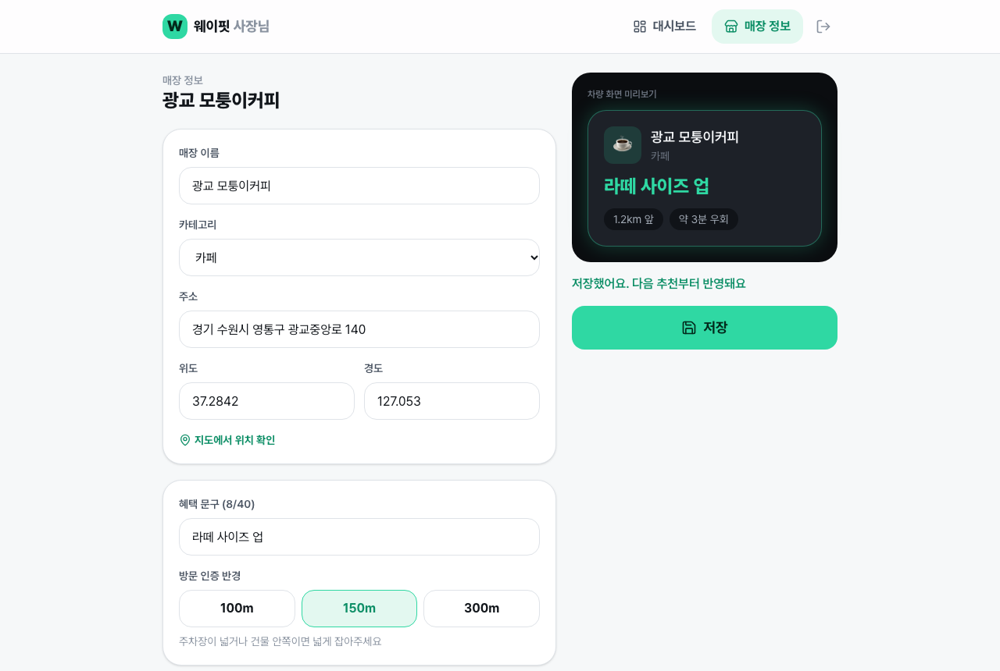

# 웨이핏 PWA — 쿠폰 지갑 + 사장님 웹

차에서 인증된 방문의 쿠폰을 **폰에서 받아 계산대에서 쓰는** 운전자용 쿠폰 지갑과, 소상공인이 혜택을 관리하고 실제 방문 효과를 보는 **사장님 웹**.
앱 설치·회원가입 없이 차 화면 QR 한 번으로 연결된다.

- 스펙: `wayfit/specs/pwa/Spec.md` · 계획: `wayfit/specs/pwa/Plan.md`
- 디자인 규칙: [docs/DESIGN_SYSTEM.md](docs/DESIGN_SYSTEM.md)

## 화면
| 쿠폰함 | 계산대 화면 | 직원 PIN | 사용 완료 |
|---|---|---|---|
|  |  |  |  |

| 사장님 대시보드 | 매장 정보 · 차량 화면 미리보기 |
|---|---|
|  |  |

## 스택
Vite · React 19 · TypeScript · React Router · TanStack Query(+ localStorage 영속화) · Tailwind v4 · vite-plugin-pwa · MSW(목 API) · Vitest + Testing Library · Playwright

## 실행
```bash
npm install
npm run dev          # http://localhost:5173 — 백엔드 연동 전까지 MSW 목 API 로 동작
npm test             # 단위·화면 테스트 (Vitest, 목 API 공유)
npm run e2e          # 브라우저 E2E (Playwright, 개발 서버 자동 실행)
npm run screenshots  # E2E 를 돌리며 docs/screenshots 갱신
npm run build        # 프로덕션 빌드 (실제 API, PWA 서비스 워커 등록)
npm run build:demo   # 시연용 빌드 (목 API 포함) → dist-demo/
```

### 환경 변수
| 이름 | 기본값 | 설명 |
|---|---|---|
| `VITE_API_BASE` | `/v1` | 백엔드 주소 (예: `https://api.wayfit.app/v1`) |
| `VITE_USE_MOCK` | — | `true` 면 프로덕션 빌드에서도 목 API 사용 (시연용). 이때 PWA 서비스 워커는 등록하지 않는다 (MSW 워커와 범위 충돌) |

## 목 API 데모 값
| 항목 | 값 |
|---|---|
| 연결 코드 | 차 화면에 뜬 **아무 8자리 코드** 정상 · `00000000` 만료 · `11111111` 이미 사용 · `99999999` 없는 코드 |
| 매장 PIN | `1234` (5회 틀리면 15분 잠금) |
| 사장님 계정 | `owner@wayfit.app` / `wayfit1234` |

목 데이터는 페이지를 새로 불러오면 초기화된다.

## 구조
```
src/
├── api/        client(fetch + Bearer) · errors(에러 코드 → 문장) · types(백엔드 계약) · queries(TanStack 훅)
├── mocks/      db(데모 데이터) · handlers(백엔드 Spec 동작 흉내) · browser/node(MSW)
├── lib/        auth(토큰) · coupon(분류·정렬·표시) · stats(전환율) · online
├── ui/         Button · Card/Badge/Page · Ticket · Sheet · OfflineBanner
├── features/
│   ├── pair/       차 QR 연결 (/pair?code=)
│   ├── coupons/    쿠폰함 · 계산대 화면 · PIN 패드 · 사용 완료
│   ├── settings/   연결된 차 관리
│   ├── install/    홈 화면 추가 안내
│   └── owner/      로그인 · 대시보드 · 매장 정보(+차량 카드 미리보기)
├── router.tsx
└── main.tsx    목/실제 API 분기, PWA 등록, 쿼리 캐시 영속화
e2e/            Playwright 시나리오
```

## 백엔드 연동 시
`src/api/types.ts`와 `src/mocks/handlers.ts`가 백엔드 Spec(Public API·Data Contracts)을 따른다. 백엔드가 배포되면 `VITE_API_BASE`만 지정하면 된다.
